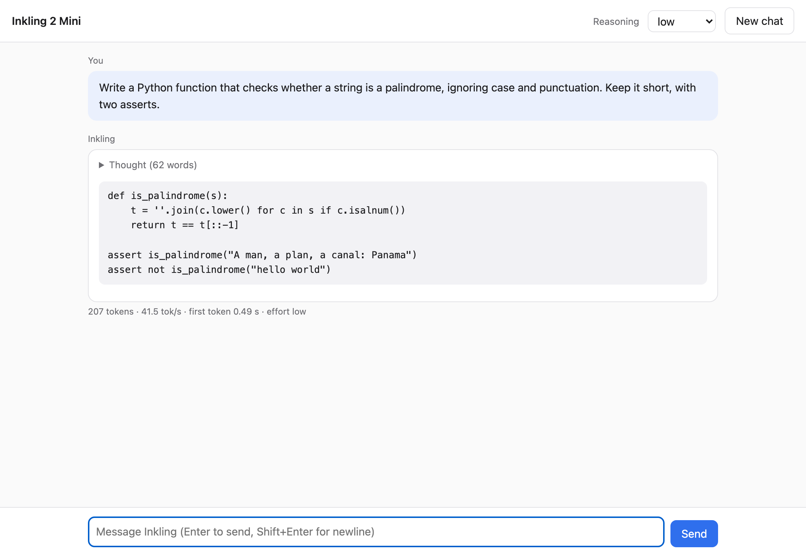

# inky

Run [Inkling 2 Mini](https://huggingface.co/thinkingmachines/Inkling-2-Mini) (Thinking Machines Lab, 26.4B total / 3.4B active, looped MoE) locally on Apple Silicon, as fast as the hardware allows, with one command.

<picture>
  <source media="(prefers-color-scheme: dark)" srcset="docs/ui-dark.png">
  
</picture>

```
$ inky

Inkling is ready  (reasoning effort: low, context: 32768)

  Chat in your browser:  http://127.0.0.1:8089/

  For coding agents (OpenAI-compatible):
    Base URL:  http://127.0.0.1:8089/v1
    Model:     inkling-2-mini:latest
    API key:   any value (e.g. "local")
```

## Requirements

- **A Mac with Apple Silicon** (M1 or newer) and **at least 32 GB of memory**
- **About 25 GB of free disk space** for the model
- **[Ollama](https://ollama.com/download)** 0.40.17 or newer. It's free and open source, and it does the actual model running. If it's missing, `setup.sh` points you to the download page.
- **Python 3.** macOS includes it. If it's missing, run `xcode-select --install`.

## Install

```sh
git clone https://github.com/johngribbin/inky.git
cd inky
./setup.sh
```

Setup walks you through five steps and asks before each change:

1. Checks your Mac meets the requirements.
2. Checks for Ollama, and opens the download page if it's missing.
3. Lets you pick a model (the official Inkling 2 Mini is recommended) and downloads it, about 20 GB.
4. Asks what you want to type to start it (default: **`inky`**) and offers to add `~/.local/bin` to your PATH.
5. Optionally starts Inkling at login, so coding agents can always reach it. This is off by default because it keeps about 22 GB of memory in use.

`./setup.sh --yes` accepts all the defaults. Re-running it is safe.

## Use

```sh
inky                 # start, then open the chat UI (Ctrl+C stops it)
inky use <model>     # download a model if needed and make it the default
inky models          # list downloaded models and show the current default
inky help
```

Running `inky` while it's already up just opens the chat UI.

You get:

- **A fast engine.** Ollama's MLX runner with the official NVFP4/MXFP8 weights and the bundled DSpark draft model for speculative decoding.
- **A low reasoning effort by default.** The model's chat template defaults to *high*, and most coding agents never send `reasoning_effort`, so every request spends thousands of tokens thinking. A small proxy fills in a default when the client doesn't set one.
- **A sensible context size.** 32k instead of the 1M maximum, so the KV cache stays small.
- **A minimal chat UI** with streaming, collapsible thinking, a reasoning-effort picker and tok/s per reply.
- **An OpenAI-compatible API** for coding agents and other tools.

## Other models and variants

Any model Ollama can run works, including community builds from Hugging Face:

```sh
inky use inkling-2-mini                      # the official build (default)
inky use hf.co/<user>/<repo>:Q8_0            # a GGUF from Hugging Face
inky use default                             # back to the official build
```

Community GGUF builds (fine-tunes, other quantizations) run on Ollama's llama.cpp engine instead of MLX, so expect them to be slower, and not every upload supports Inkling's looped architecture. On Apple Silicon, prefer Q8_0 or Q4_K_M over IQ and very-low-bit quants. Models that don't support thinking get no reasoning effort injected.

## Settings

Override any setting with an environment variable:

| Variable | Default | What it does |
|---|---|---|
| `INKY_EFFORT` | `low` | Default reasoning effort: `none`, `minimal`, `low`, `medium`, `high`, `xhigh`, `max`, or `default` to inject nothing |
| `INKY_PORT` | `8089` | Port for the chat UI and API |
| `INKY_CTX` | `32768` | Context length (the model supports up to 1M) |
| `INKY_MODEL` | saved by `inky use` | Model for this run only |
| `INKY_BACKEND_PORT` | `11435` | Port of the private Ollama instance |
| `INKY_OPEN` | `1` | Set to `0` to skip opening the browser |

Example: `INKY_EFFORT=high INKY_CTX=65536 inky`

Clients can also set the effort per request, and that always takes precedence:

```sh
curl http://127.0.0.1:8089/v1/chat/completions -H 'Content-Type: application/json' -d '{
  "model": "inkling-2-mini:latest",
  "reasoning_effort": "high",
  "messages": [{"role": "user", "content": "Write a binary search in Rust"}]
}'
```

## Privacy and what it touches

inky is plain shell, Python and HTML with no dependencies, so you can read all of it in a few minutes.

- **No telemetry, analytics or tracking.** inky never sends data anywhere. The chat UI loads nothing from the internet.
- **Local-only network access.** Everything listens on `127.0.0.1`, so other devices on your network can't reach it.
- **Ollama's online extras are off.** inky runs Ollama with `OLLAMA_NO_CLOUD=1`, which turns off its cloud features and the model recommendations it otherwise fetches at startup. The only download is the model you choose, from Ollama's registry or Hugging Face.
- **No sudo, no system changes.** It doesn't change your Ollama app's settings; it runs its own Ollama instance on a separate port and shares the downloaded models.
- **Everything it creates:**
  - `~/.local/bin/inky`: a link to `inky` in this folder
  - A marked 3-line block in `~/.zshrc` (or `~/.bash_profile`), only if you agree
  - `~/.config/inky/model`: your chosen model, only if you change it
  - `~/.local/state/inky/`: logs
  - `~/Library/LaunchAgents/io.github.inky.plist`: only if you opt in to starting at login
- **`./uninstall.sh` removes all of it** and asks before deleting the model. Ollama itself is left installed.

## Notes from the model card

- **Sampling:** the official `generation_config` sets only `temperature: 1.0`. Nothing else is tuned.
- **Precision:** the weights are natively NVFP4 and MXFP8. "8-bit" community conversions upcast from that, so they add no quality and run slower.
- **Effort:** the template's `none` is only "effort level 0": the model still thinks, and Ollama then drops that thinking from the reply, so a client pays for tokens it can't see or stop. inky makes `none` mean **no thinking**: for plain-text chats with an Inkling model the proxy writes the prompt itself and opens the model's turn as text, so it answers straight away. Trade-off: with no thinking at all, answers that need reasoning get worse (it gets simple arithmetic wrong); use `minimal` for a little thinking. Requests with tools or images go to Ollama unchanged. The looped middle layers run three times per token regardless.
- **Loops:** the model can get stuck in long reasoning loops, especially when debugging code. Cap `max_tokens` and agent turns.

## Benchmarks

Measured on an M4 Max with 128 GB. The full method and numbers are in [`bench/results.md`](bench/results.md).

| Setup | Effort | Gen tok/s | 13.6k-token prompt, time to first token | Coding task, total time |
|---|---|---|---|---|
| llama.cpp, UD-Q4_K_XL GGUF + DSpark draft | high (template default) | 34–39 | 50 s | 81–106 s |
| **inky** (Ollama MLX, official weights) | **low** | **55–60** | **27–31 s** | **15–16 s** |
| inky | high | 47–51 | — | 68–76 s |

Run it yourself against a running server:

```sh
python3 bench/bench.py http://127.0.0.1:8089/v1 inkling-2-mini:latest low --runs 2
python3 bench/bench.py http://127.0.0.1:8089/v1 inkling-2-mini:latest high --runs 2
python3 bench/bench.py http://127.0.0.1:8089/v1 inkling-2-mini:latest low --long --max-tokens 64
```

## Why not mlx-lm or llama.cpp?

- **mlx-lm:** Inkling support is in an open pull request ([ml-explore/mlx-lm#2086](https://github.com/ml-explore/mlx-lm/pull/2086)) and not yet released. Ollama already runs the model on MLX and includes the speculative draft model.
- **llama.cpp:** works, and comes with a nicer built-in web UI, but on Apple Silicon it was about 30% slower at generation and about 45% slower at prompt processing in the tests above.

## Files

- `setup.sh` / `uninstall.sh`: install and remove
- `inky`: the launcher (settings at the top)
- `proxy.py`: stdlib-only proxy that serves the UI, injects the default effort and answers `none` without thinking
- `chat.html`: the chat UI, a single file with no dependencies
- `bench/bench.py`: benchmark for any OpenAI-compatible endpoint

## License

MIT. Inkling 2 Mini itself is Apache 2.0, from Thinking Machines Lab. This project is not affiliated with them.
